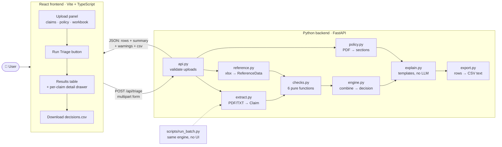
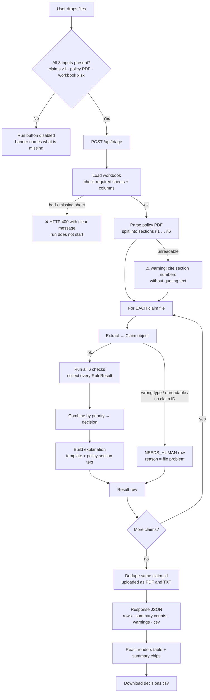
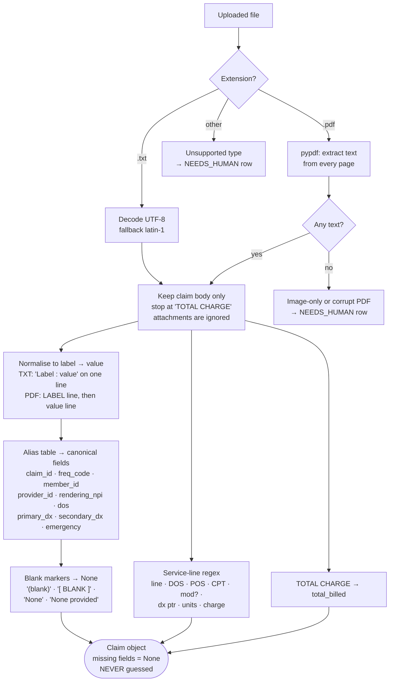
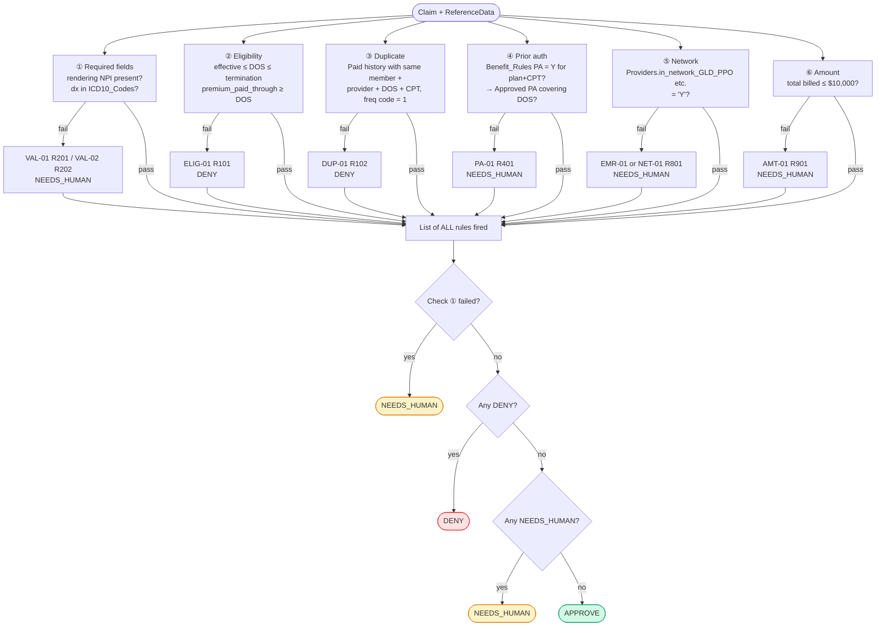
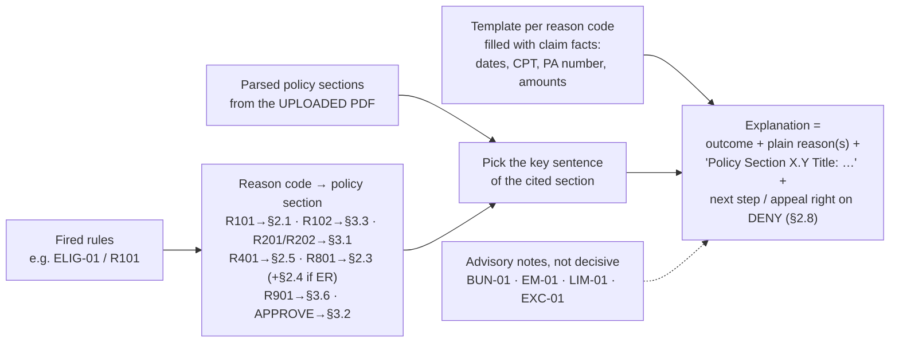
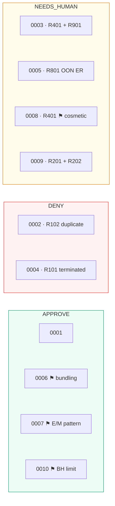
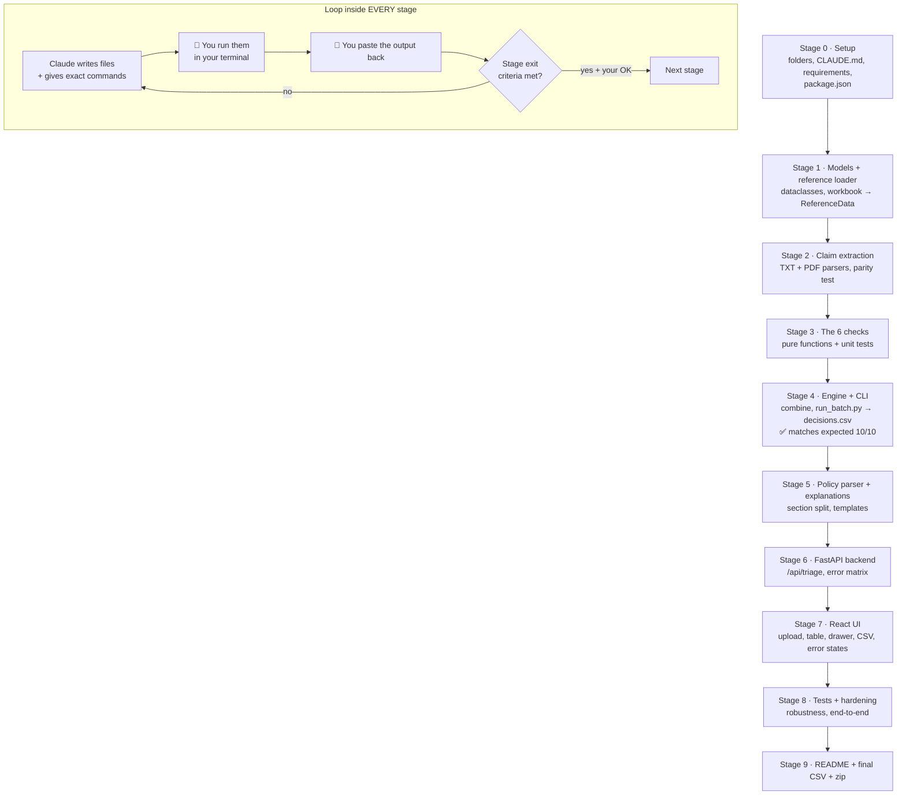

# Mini Claims Triage Assistant: Flowcharts

> **Status: DRAFT FOR REVIEW.** The stage-by-stage plan, the system prompts and `CLAUDE.md` come after you approve this.
> Diagrams are Mermaid. They render in GitHub, VS Code (Markdown Preview Mermaid extension) or https://mermaid.live.

**Decisions locked in:**

- **React** frontend, with a **Python (FastAPI)** backend for the checks. Python is preferred by the brief.
- **Zero LLM** anywhere. Decisions come from code plus workbook data. Explanations are **template-based** and cite the uploaded policy.
- **You run every command.** Claude writes the files and the commands; you run them and paste the output back.

---

## 1. System architecture

**Run modes:**

- **Dev:** two terminals, `uvicorn` on port 8000 and `vite` on port 5173 with a proxy to `/api`.
- **Submission:** `npm run build`, then FastAPI serves the built React app. A grader needs **one command** to run it.

---

## 2. End-to-end data flow (one run)

> Each claim runs inside its own `try/except`. One bad claim never stops the batch.

---

## 3. Claim extraction (PDF and TXT → one `Claim`)

**Guarantees:**

- The TXT and PDF versions of each claim must produce **identical** `Claim` objects. A test enforces this for all 10.
- Attachment text never fills a field. Claim 0009's OCR note cannot hide its blank NPI.

---

## 4. The 6 checks and the decision logic

**Rules for missing data:**

- A field a check needs is missing → that check returns NEEDS_HUMAN with "cannot verify". It never passes or denies by default.
- The member or provider is not in the workbook → NEEDS_HUMAN, not DENY.

---

## 5. Explanation builder (deterministic, no LLM)

> The explanation uses only the claim ID, member ID, rule results and policy text. No birth year, sex or other personal fields (Policy §3.8).

---

## 6. Expected outcome for the 10 claims

⚑ = an advisory note from the full policy. It is mentioned in the explanation and README, but it does not change the 6-check decision.

---

## 7. Build stages and how we work together

**Stage gates:**

- **Gate A:** after Stage 4, all 10 decisions are correct. This is the 35-point area, so it is locked down before any UI work.
- **Gate B:** after Stage 7, the full UI flow works in your browser.
- **Gate C:** after Stage 9, the zip is ready.

---

### Review checklist for you

- [ ] React + FastAPI split, with FastAPI serving the built React app for submission. OK?
- [ ] Template-only explanations, no LLM anywhere. OK? The README will say "template-based".
- [ ] Advisory notes (bundling, E/M, BH limit, cosmetic) appear in the explanation but don't change decisions. OK?
- [ ] 10 stages with 3 gates. Merge or split any?
