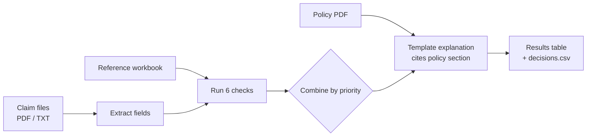

# Mini Claims Triage Assistant


A small web app that triages health insurance claims. Upload claim files (PDF or TXT), a policy document and a reference workbook. Every claim comes back as **APPROVE**, **DENY** or **NEEDS_HUMAN**, with the rules that fired and a plain-language explanation that cites the policy. Results can be downloaded as `decisions.csv`.

Every decision comes from plain, testable rules and the reference data. **No LLM is used anywhere**, not even for the explanations.

> All data in this repo is synthetic. No real people, providers or health information.


---

## Features

- **Reads PDF and TXT claims.** One parser handles both layouts, and a test proves the two formats give identical fields for every sample claim.
- **Six deterministic checks**, each written as a pure function:
  - required fields and a valid diagnosis code;
  - eligibility on the date of service;
  - duplicates of paid claims;
  - prior authorization;
  - network status;
  - the $10,000 amount limit.
- **Explanations that cite the policy.** Each reason quotes the matching section of the *uploaded* policy PDF, e.g. *Section 2.1 Eligibility*. Denials include the appeal right.
- **Never guesses.** Blank or malformed values stay missing, so a code like `J06.99` is never auto-corrected to `J06.9`.
- **Handles bad input gracefully.** An unreadable or wrong-type file becomes a NEEDS_HUMAN row, and the rest of the batch keeps going.
- **Reviewer notes.** Extra policy rules (bundling, billing patterns, visit limits, cosmetic exclusions) are flagged on the claim without changing the decision.
- **Same CSV everywhere.** The UI download and the command-line output are byte-for-byte the same, and this is tested.

## How it works



**Decision priority** (all six checks always run, and every rule that fires is listed):

1. Required fields missing or invalid → `NEEDS_HUMAN`
2. Otherwise, any check says deny → `DENY`
3. Otherwise, any check needs a person → `NEEDS_HUMAN`
4. Otherwise → `APPROVE`

| # | Check | If it fails | Reason code |
|---|---|---|---|
| 1 | Rendering NPI and other required fields present, and diagnosis code in the ICD-10 table | NEEDS_HUMAN | R201 / R202 |
| 2 | Member covered on the date of service | DENY | R101 |
| 3 | Not a duplicate of a paid claim | DENY | R102 |
| 4 | Approved prior authorization when the plan requires one | NEEDS_HUMAN | R401 |
| 5 | Provider in-network for the member's plan | NEEDS_HUMAN | R801 |
| 6 | Total billed is $10,000 or less | NEEDS_HUMAN | R901 |

## Quick start

You only need **Python 3.11**. The built UI is served by the backend.

```bash
cd claims_triage/backend
python -m venv .venv

# Windows
.\.venv\Scripts\python -m pip install -r requirements.txt
.\.venv\Scripts\python -m uvicorn api:app --port 8000

# macOS / Linux
.venv/bin/python -m pip install -r requirements.txt
.venv/bin/python -m uvicorn api:app --port 8000
```

Open **http://127.0.0.1:8000**. Upload the files from `claims_triage/sample_data/` and click **Run triage**. The API docs are at `/docs`.

> If `claims_triage/frontend/dist` is missing (it isn't committed), build the UI once first:
> `cd claims_triage/frontend && npm install && npm run build`. This needs Node 18+.

### Other ways to run it

| What | Command (from `claims_triage/backend`) |
|---|---|
| Command line, writes `output/decisions.csv` | `python scripts/run_batch.py` |
| Tests | `python -m pytest` |
| UI dev server with hot reload | `cd ../frontend && npm install && npm run dev` (http://localhost:5173, proxies `/api` to :8000) |

## Results on the sample data

| Claim | Decision | Why |
|---|---|---|
| CLM-2026-0001 | ✅ APPROVE | All checks passed |
| CLM-2026-0002 | ⛔ DENY | Duplicate of paid claim H-1001 (R102) |
| CLM-2026-0003 | 👤 NEEDS_HUMAN | No approved prior auth for 29881, and $18,500 is over the limit (R401, R901) |
| CLM-2026-0004 | ⛔ DENY | Coverage ended 2026-09-28; service on 2026-09-30 (R101) |
| CLM-2026-0005 | 👤 NEEDS_HUMAN | Out-of-network emergency room (R801) |
| CLM-2026-0006 | ✅ APPROVE | All checks passed (reviewer note: bundled lab tests) |
| CLM-2026-0007 | ✅ APPROVE | All checks passed (reviewer note: unusual level-5 billing) |
| CLM-2026-0008 | 👤 NEEDS_HUMAN | Prior auth required and none on file (R401) |
| CLM-2026-0009 | 👤 NEEDS_HUMAN | Rendering NPI missing; J06.99 not a valid code (R201, R202) |
| CLM-2026-0010 | ✅ APPROVE | All checks passed (reviewer note: therapy visit limit reached) |

**4 approved · 2 denied · 4 need a human.** The full explanations are in [`claims_triage/output/decisions.csv`](claims_triage/output/decisions.csv).

## Screenshots

| Upload and run | Claim details |
|---|---|
|  |  |

## Project structure

```
claims_triage/
├── backend/
│   ├── api.py               # FastAPI: /api/health, /api/triage (HTTP only)
│   ├── schemas.py           # response models
│   ├── triage/
│   │   ├── extract.py       # PDF/TXT → Claim
│   │   ├── reference.py     # workbook → reference data (never reads the Claims sheets)
│   │   ├── checks.py        # the 6 checks, pure functions
│   │   ├── engine.py        # run checks, combine, batch handling
│   │   ├── policy.py        # split the policy PDF into sections
│   │   ├── explain.py       # template explanations
│   │   ├── advisories.py    # non-decisive reviewer notes
│   │   └── export.py        # decisions.csv
│   ├── scripts/             # run_batch.py (CLI), dump_extracted.py
│   └── tests/               # 203 tests
├── frontend/                # React + TypeScript (Vite), hand-written CSS
├── sample_data/             # 10 claims (PDF + TXT), workbook, policy
└── output/                  # decisions.csv, extracted_claims.csv
```

## API

`POST /api/triage` takes a multipart form:

| Field | Files |
|---|---|
| `claims` | one or more `.pdf` / `.txt` |
| `policy` | one `.pdf` |
| `workbook` | one `.xlsx` |

It returns `summary`, `results` (decision, rules fired, reason codes, explanation, reviewer notes, extracted fields and all check results), `warnings` and `csv`. Input problems come back as `{"error": "...", "detail": "..."}` with a 400 or 413 status.

## Testing

```bash
cd claims_triage/backend
python -m pytest
```

The 203 tests cover:
- PDF/TXT extraction and parity;
- every check, including edge cases;
- the decision priority;
- the expected result for all 10 claims;
- policy citations and privacy in explanations;
- the API error handling;
- messy inputs (empty, blank or unsupported files, missing fields, conflicting copies, broken workbooks);
- byte-identical CSVs from the CLI and the API.


## Limitations

The six checks follow the brief exactly, so a few claims are approved that the full policy would question. The app shows these as reviewer notes:

- **CLM-2026-0006:** no line-level bundling check (82947 and 82565 are part of 80053).
- **CLM-2026-0007:** no provider billing-pattern review (79% level-5 visits vs an 8% peer median).
- **CLM-2026-0010:** no benefit-limit check (12 of 12 therapy visits used; this needs a parity review).

Other gaps:
- **CLM-2026-0008** looks clearly cosmetic, which the policy would allow to be denied outright.
- **The parser** is built for this claim layout.
- **Not implemented:** timely filing, pricing and cost share, and OCR for image-only PDFs.

## Tech stack

- **Backend:** Python 3.11, FastAPI, pypdf, openpyxl, pytest
- **Frontend:** React 18, TypeScript (strict), Vite, lucide-react icons, IBM Plex fonts. No UI component library.
